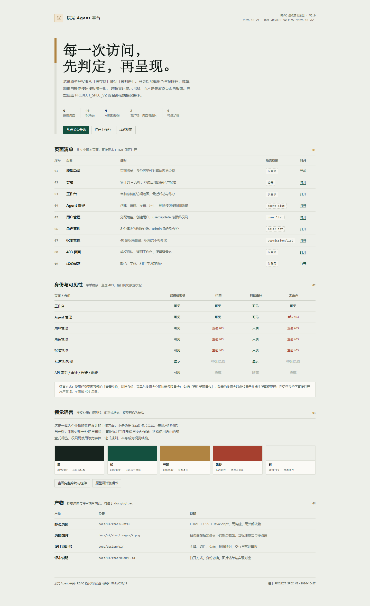
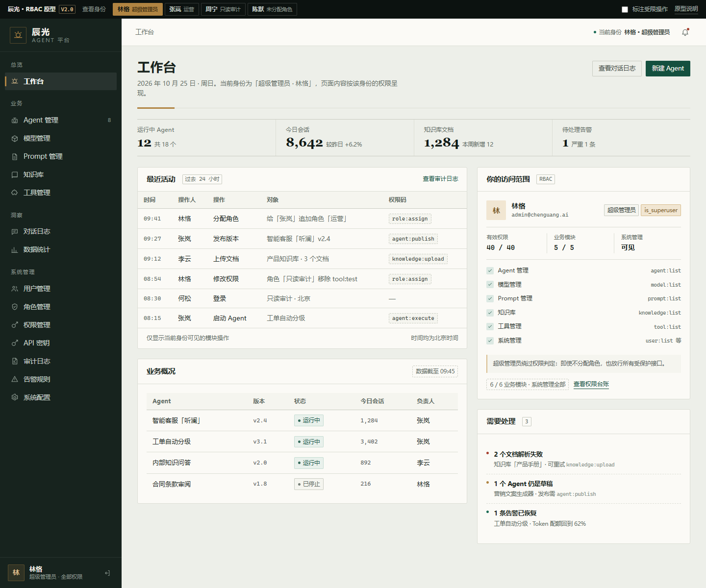
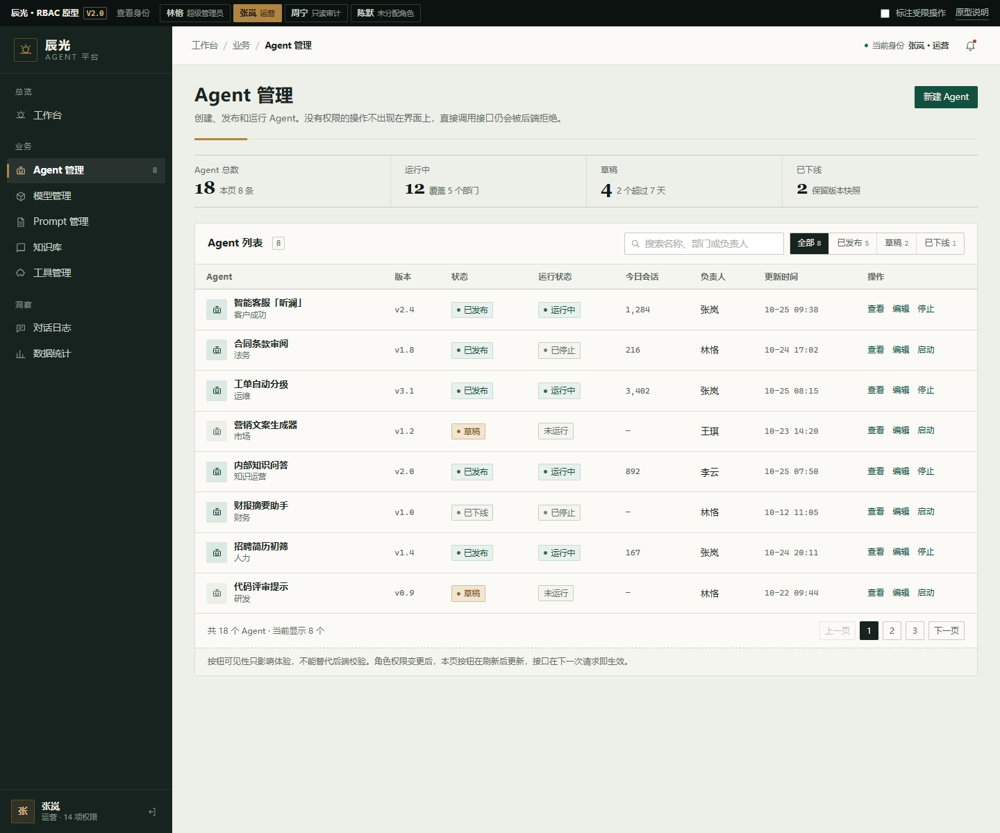
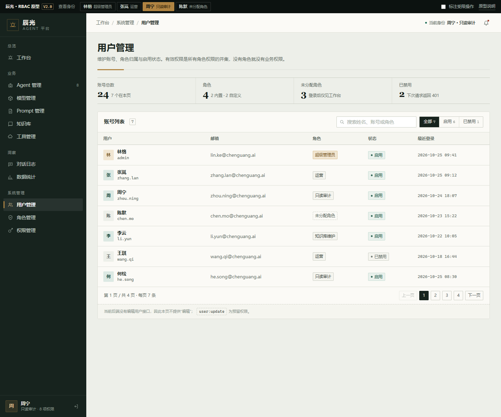
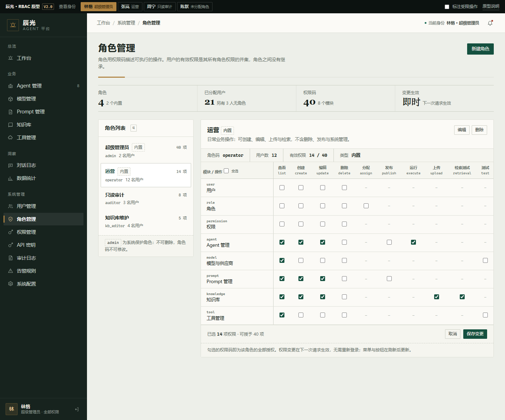
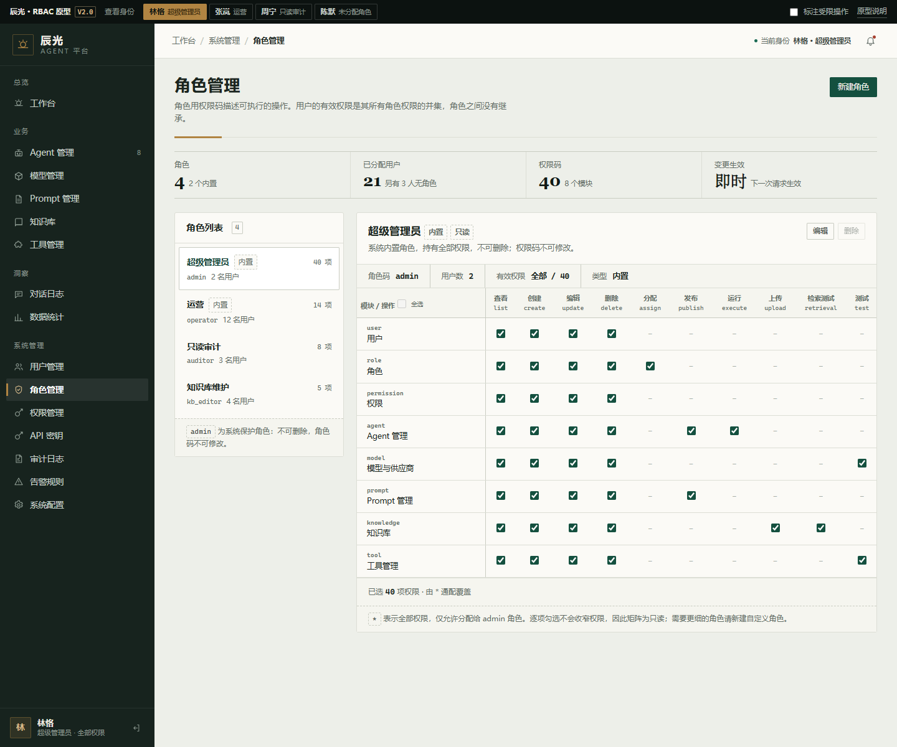
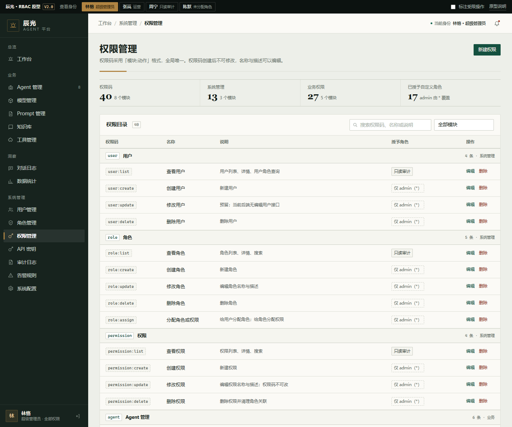
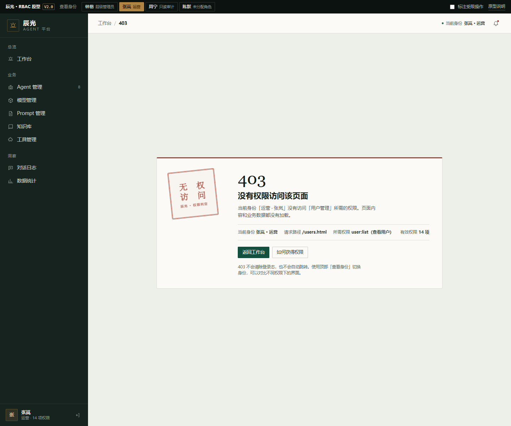

# 辰光 Agent 平台 · RBAC 授权界面原型设计说明书

| 项目 | 内容 |
|---|---|
| 文档版本 | V1.0 |
| 编写日期 | 2026-10-27 |
| 基线文档 | [`docs/spec/PROJECT_SPEC_V2.md`](../../spec/PROJECT_SPEC_V2.md) |
| 原型目录 | [`docs/ui/rbac/`](../../ui/rbac/) |
| 图片产物 | [`docs/ui/rbac/images/`](../../ui/rbac/images/)，共 19 张 |
| 评审说明 | [`docs/ui/rbac/README.md`](../../ui/rbac/README.md) |
| 文档状态 | 已完成，供评审与前端实现参考 |
| 覆盖范围 | 前端授权体验：登录、菜单/路由/按钮权限、403、用户/角色/权限管理、Mock 身份 |
| 不覆盖 | 后端鉴权实现、数据库迁移、真实接口联调、未实现模块的页面 |

---

## 1. 目的与范围

本文说明 RBAC 授权界面的视觉系统、页面结构、权限可见性规则与交互约定。它解决的不是“把权限数据填进表单”，而是让三类人各自看到合适的界面：

- **超级管理员**：确认谁有什么权限，处理越权与配置；
- **运营 / 业务人员**：只看到自己能用的模块和操作，不被无权限入口干扰；
- **只读审计 / 新用户**：明确知道当前范围，遇到拒绝时有明确的下一步。

原型依据 `PROJECT_SPEC_V2` 第 8 节的前端需求，覆盖 9 个原型页与 1 个模块占位页，并以四种可切换身份演示同一套页面在不同权限下的差异。后端鉴权规则（§5.3、§7.3）以权限码和文案的形式体现在界面中，但不在本原型内实现。

**设计目标**

1. 权限判定**可见**：当前身份、有效权限数、可见模块、所需权限码都能在界面上找到。
2. 无权限时**隐藏而非禁用**：不给出“看得到、点不动”的入口；整列操作都无权时隐藏整列。
3. 拒绝**可解释、可恢复**：403 说明请求路径、所需权限和当前身份，提供返回工作台的出口。
4. 管理动作**可核对**：角色矩阵、权限目录、删除影响面、`admin` 保护规则都有明确的界面表达。
5. 与现有工程**可落地**：沿用侧边栏 + 内容区的信息架构，令牌和组件可映射到现有 React + shadcn 体系。

---

## 2. 设计概念

### 2.1 主题与受众

- 产品：辰光 Agent 平台，企业级智能 Agent 管理。
- 本轮主题：RBAC 授权，即“谁能看到什么、谁能做什么”。
- 主要受众：平台超级管理员、日常运营人员、只读审计人员，以及被分配了自定义角色的普通用户。
- 页面的主要任务：查看与核对权限、调整角色、处理越权、按权限使用业务模块。

### 2.2 视觉母题：授权台账

RBAC 的核心产物不是“卡片”，而是一条条可核对的授权记录：谁、通过哪个角色、获得了哪个权限码。原型把这种“台账”感作为视觉母题：

- **规则线**：面板、表头、矩阵以 1px 细线和列分隔组织信息，而不是悬浮卡片和阴影；
- **权限码**：`模块:动作` 以等宽字体、虚线边框呈现，像一枚枚待核对的条目；
- **印章**：状态与 403 使用方正、双线边框的印章样式，拒绝用朱砂，允许用松绿；
- **身份卡**：侧边栏底部常驻当前身份与权限数，页面顶部控制条可切换身份，让“权限差异”成为可以直接观察的对象；
- **唯一的自动动效**：页面标题下的黄铜规则线在加载时从左展开 550ms，除此之外没有逐区块淡入或卡片悬停放大。

**标志性元素**：身份切换 + 角色权限矩阵 + 403 印章。三者都直接服务于 RBAC，而不是装饰。

**外壳线框**

```text
┌ 原型控制条 · 身份切换 · 标注受限操作 ─────────────────────────────┐
├──────────────┬────────────────────────────────────────────────────┤
│ 辰光          │ 工作台 / 系统管理 / 用户管理        当前身份 · 铃铛  │
│ AGENT 平台    ├────────────────────────────────────────────────────┤
│              │ 用户管理                            [新建用户]      │
│ 总览          │ 维护账号、角色归属与启用状态                       │
│  工作台       │ ─────────────────────────────                     │
│ 业务          │ 24 账号 │ 4 角色 │ 3 未分配 │ 2 已禁用             │
│  Agent 管理   │ ┌ 账号列表 ────────────────────────────────────┐   │
│  模型管理     │ │ 用户      邮箱      角色    状态   最近登录   │   │
│  ...          │ │ 林恪      lin.ke@…  超管    启用   10-25     │   │
│ 系统管理      │ │ 张岚      zhang…    运营    启用   10-25     │   │
│  用户管理     │ └──────────────────────────────────────────────┘   │
│  角色管理     │                                                    │
│  权限管理     │                                                    │
│ 身份卡 / 退出 │                                                    │
└──────────────┴────────────────────────────────────────────────────┘
```

**权限矩阵线框**

```text
模块 / 操作   查看  创建  编辑  删除  分配  发布  运行  上传  检索  测试
user          ☑     ☐     ☐     ☐     —     —     —     —     —     —
role          ☑     ☐     ☐     ☐     ☐     —     —     —     —     —
permission    ☑     ☐     ☐     ☐     —     —     —     —     —     —
agent         ☑     ☑     ☑     ☐     —     ☐     ☑     —     —     —
model         ☑     ☐     ☐     ☐     —     —     —     —     —     ☐
prompt        ☑     ☑     ☑     ☐     —     ☐     —     —     —     —
knowledge     ☑     ☑     ☑     ☐     —     —     —     ☑     ☑     —
tool          ☑     ☐     ☐     ☐     —     —     —     —     —     ☐
```

### 2.3 刻意避免的默认做法

| 避免 | 原因 |
|---|---|
| 通用蓝色 SaaS 后台 + 同质圆角卡片堆叠 | 与权限主题无关，任何后台都能套用；既有 V1–V9 原型已呈现这种风格 |
| 暖米色背景 + 高对比衬线 + 赤陶色强调 | 是当前生成式设计最常见的组合，容易让项目失去辨识度 |
| 近黑背景 + 单一荧光色、报纸式密集细线 | 与“企业权限管理”的稳重语境不符 |
| 每个区块淡入上浮、每张卡片悬停放大 | 与任务无关的动效噪音；全页只保留标题规则线一个自动动效 |
| 胶囊标签、全大写标签、`A · B · C` 元信息、无意义编号 | 模板化痕迹重；编号只用于页面清单与判定步骤这类真实序列 |
| 装饰性渐变、玻璃拟态、彩色阴影 | 不用装饰掩盖信息结构 |
| 无权限时显示禁用按钮 | 用户会反复尝试；隐藏更符合“最小惊讶”，也减少无效点击 |

### 2.4 与 V1–V9 原型的关系

信息架构保持一致：248px 侧边栏、顶部面包屑、表格 + 工具栏、分页、对话框。视觉层为权限控制台重新设计：

- 用墨绿/松绿/黄铜/朱砂/浅石色替换通用蓝；
- 圆角统一为 2–3px，去掉卡片阴影与渐变，改用细线和台账式摘要；
- 状态从彩色胶囊改为方正的印章式标签；
- 权限码成为独立的信息单位，而不是普通文本。

这样既不推翻既有页面结构，又能让本次 RBAC 原型有独立的视觉识别，后续可直接映射到现有 shadcn 组件与 CSS 变量。

---

## 3. 设计令牌

### 3.1 颜色

| 令牌 | 色值 | 用途 | 对比度（相对纸面 `#FBFAF6`） |
|---|---|---|---|
| `ink-950` | `#0C1210` | 原型控制条、代码块 | 与浅色文字 14:1 以上 |
| `ink-800` | `#17231E` | 侧边栏、深色区域 | 侧边栏文字 `#C6D0C9` 为 10.24:1 |
| `pine-700` | `#14503F` | 主按钮、允许、运行中 | 8.94:1 |
| `brass-500` | `#B08442` | 当前身份、规则线、焦点环 | 作为底色配 `#1B241F` 文字为 4.72:1 |
| `brass-700` | `#7A5723` | 黄铜系文字、草稿 | 6.25:1 |
| `cinnabar-600` | `#A6402F` | 403 边框、删除、拒绝 | 作边框/色块；文字用 `cinnabar-700` |
| `cinnabar-700` | `#8F3325` | 危险文字、印章 | 7.54:1 |
| `stone-50` | `#FBFAF6` | 面板、表格、对话框 | 纸面基准 |
| `stone-200` | `#EDEFE9` | 页面底色 | — |
| `text-900` | `#1B241F` | 标题与正文 | 15.25:1 |
| `text-600` | `#55605A` | 次级正文、说明 | 6.27:1 |
| `text-500` | `#626C65` | 表头、元信息、辅助说明 | 5.22:1；在页面底色上 4.70:1 |
| `text-400` | `#8B958E` | 仅装饰性图标/占位 | 2.96:1，不用于必要信息 |

用色规则：

- 松绿只表示“允许 / 主操作 / 运行中”，不用于装饰；
- 朱砂只表示“拒绝 / 删除 / 403”，不用于普通提醒；
- 黄铜只标记“当前身份 / 结构线 / 焦点”，不承担状态语义；
- 状态标签同时带圆点和文字，不依赖单一颜色；
- 表单始终有可见 `<label>`，占位符只作补充，不承担唯一提示。

### 3.2 字体

| 角色 | 字体栈 | 用法 |
|---|---|---|
| 展示 | `Georgia, "Songti SC", "STSong", "SimSun", serif` | 封面大标题、登录页「辰光」、403 数字、印章、台账数字 |
| 界面 | `"Microsoft YaHei UI", "Microsoft YaHei", "PingFang SC", "Segoe UI", system-ui, sans-serif` | 标题、正文、表格、表单 |
| 等宽 | `"Cascadia Code", "Consolas", "SFMono-Regular", monospace` | 权限码、账号、版本号、日期、计数 |

全部使用系统字体，不加载网络字体：避免首屏抖动，离线打开也能保持排版。中文展示字由宋体/思源宋体回退承担，刻意保留“文档/台账”的质感；界面正文使用无衬线，保证小字号可读性。

**字号阶梯**

| 层级 | 字号 / 行高 | 用途 |
|---|---|---|
| 封面标题 | 54 / 1.16 | 原型导览首屏 |
| 登录展示字 | 66 / 1.08 | 登录页品牌区 |
| 页面标题 | 26 / 1.3 | 各业务页 `h1` |
| 面板标题 | 14.5 / 1.5 | 面板 `h2` |
| 表格主字段 | 13 / 1.5 | 表格内容 |
| 表头 / 说明 | 11.5 / 1.6 | `th`、元信息、辅助说明 |
| 权限码 | 11 / 1.6 | 等宽权限码 |

正文行长：说明文字最大 72ch（中文约 36 字）；表格与权限码不按字符限制，改为固定列宽 + 横向滚动。

### 3.3 间距、圆角与阴影

- 间距以 4 为基数：4 / 8 / 12 / 16 / 20 / 24 / 32 / 40 / 56。
- 页面内边距：桌面 26px 32px 56px；`≤1180px` 24px；`≤760px` 20px 16px 44px。
- 圆角：2px（标签、按钮、输入框）、3px（面板、对话框）、方形头像 2px。
- 阴影：除对话框 `0 24px 64px rgba(12,18,16,.28)` 外全部无阴影；拒绝“同一种阴影套所有卡片”。
- 分隔：1px `#DCDED5`，强调分隔 1px `#C9CCC2`，激活标识 3px 黄铜。

### 3.4 图标

- 1.6px 描边、24×24 viewBox、16px 显示，`currentColor`。
- 线性图标，不使用 emoji；业务模块图标与侧边栏语义一一对应。
- 图标按钮带 `aria-label`；纯装饰图标 `aria-hidden="true"`。

### 3.5 动效

| 场景 | 时长 / 曲线 | 说明 |
|---|---|---|
| 标题规则线 | 550ms，`cubic-bezier(.2,.7,.2,1)` | 全页唯一的自动动效，仅加载时一次 |
| 悬停 / 焦点 | 150–160ms ease | 背景、边框、颜色 |
| 对话框 | 180ms | 透明 + 6px 上移 + 0.994 缩放 |
| 轻提示 | 200ms 进入 / 220ms 退出 | 3.2s 后自动消失 |

`prefers-reduced-motion: reduce` 下所有动画与过渡压缩到 0.001ms；不使用持续循环的脉冲、呼吸灯或自动轮播。

### 3.6 可访问性

- 正文与辅助文字对比度达到 WCAG AA（关键数值见 3.1）。
- 所有可交互元素有 2px 黄铜焦点环（偏移 2px），在深色侧边栏与浅色内容区都可见。
- 状态使用文字 + 圆点 + 颜色，不只依赖颜色；权限码为等宽字符，便于逐字核对。
- 表格使用 `thead` / `th` 语义，表单控件均有 `label`；对话框使用 `role="dialog"`、`aria-modal="true"`、`aria-labelledby`。
- 对话框打开时焦点进入第一个可操作元素；Esc 关闭；关闭后焦点回到触发按钮。
- 隐藏的权限按钮使用 CSS `display:none`，同时设置 `aria-hidden`，屏幕阅读器不会读到不存在的操作。
- 只读矩阵的复选框使用 `aria-disabled="true"` 与 `tabindex="-1"`，保留可读的勾选状态，同时阻止修改。
- 移动端侧边栏通过按钮打开，遮罩可点击关闭；表格在窄屏横向滚动，并在评审说明中注明。

---

## 4. 布局与组件

### 4.1 应用外壳

| 区域 | 规格 | 说明 |
|---|---|---|
| 原型控制条 | 38px（移动 68px） | 仅原型：身份切换、标注开关、返回导览。生产环境不出现 |
| 侧边栏 | 248px，`ink-800` | 品牌、分组导航、身份卡；`≤980px` 变为抽屉 |
| 顶栏 | 56px，`stone-50` | 面包屑、当前身份、通知；吸顶 |
| 内容区 | 最大 1240px，居中 | 页头、台账摘要、面板 |
| 侧栏分组 | 总览 / 业务 / 洞察 / 系统管理 | 组内无可见项时整组隐藏；系统管理全无权限时整组隐藏 |
| 当前项 | 3px 黄铜左条 + 轻微提亮 | 不用整块蓝色填充 |
| 身份卡 | 底部固定 | 姓名、角色、权限数、退出登录 |

断点：

- `>1180px`：标准双栏或三栏布局；
- `≤1180px`：内容内边距收紧，台账改为两列；
- `≤980px`：侧边栏变为左侧抽屉，顶栏出现菜单按钮；
- `≤760px`：单列，页头动作换行，控制条拆成两行，表格横向滚动。

### 4.2 页头与台账摘要

- 页头：26px 标题 + 一行说明（最大 72ch）+ 右侧主/次操作；操作按权限隐藏。
- 标题下 1px 分隔线与 76px 黄铜规则线；规则线是唯一自动动效。
- **台账摘要**：4 个数据格，顶/底细线，格间竖线；没有独立卡片边框，数值使用衬线体 + 等宽数字。示例：账号总数 / 角色 / 未分配角色 / 已禁用。
- 摘要下方才是操作面板；信息密度优先于装饰。

### 4.3 面板与表格

- 面板：`stone-50` 底、1px 边框、3px 圆角、无阴影；面板头 13px 上下留白 + 1px 底线。
- 面板头包含标题、计数、工具区；工具区右对齐，可换行。
- 表格：13px 正文、11.5px 表头、`stone-100` 表头底、行悬停 `#F6F7F1`；数字列使用等宽字体与 `tabular-nums`。
- 行操作使用文字按钮（松绿/朱砂），不用一排彩色图标；危险操作只用朱砂文字。
- 分页：27px 方形按钮，当前页墨色底；上一页/下一页在无数据时禁用。
- 移动端：表格设置最小宽度并在面板内横向滚动，避免把 5–8 列压成多行。

### 4.4 状态、角色与权限码

| 组件 | 规范 | 语义 |
|---|---|---|
| 印章 `stamp--on` | 松绿文字 + 浅松绿底 + 圆点 | 启用、已发布、运行中 |
| `stamp--draft` | 黄铜文字 + 浅黄铜底 | 草稿、待处理 |
| `stamp--off` | 灰色文字 + 石色底 | 已禁用、已停止、已下线 |
| `stamp--deny` | 朱砂文字 + 浅朱砂底 | 无权、阻断 |
| 角色标签 `chip--role` | 1px 边框、方形 2px 圆角 | 角色名 |
| 超级管理员标签 `chip--super` | 黄铜底 | `admin` / `is_superuser` |
| 未分配角色 `chip--muted` | 虚线边框 | 无角色 |
| 权限码 `code` | 等宽 11px、虚线边框、浅石底 | `模块:动作` |
| 允许码 `code--grant` | 松绿边/底 | 已授予 |
| 拒绝码 `code--deny` | 朱砂边/底 | 缺失/删除影响 |

不使用胶囊（`border-radius: 999px`）标签；印章统一为 2px 圆角的“方戳”。

### 4.5 按钮与表单

- 主按钮：松绿底、浅色字，32px 高；小号 27px。
- 次按钮：透明底 + 1px 石色边框；文字按钮无边框，悬停加底色。
- 危险按钮：透明底 + 朱砂边框/文字；确认删除使用该样式。
- 禁用态：42% 透明度、`cursor: not-allowed`；仅用于“所有身份都不该操作”的场景，例如删除 `admin` 角色；无权限不用禁用态，直接隐藏。
- 输入框：34px 高、1px 边框、2px 圆角；聚焦时松绿边框 + 2px 柔光。
- 表单始终有 label；提示文字 11.5px；错误提示朱砂左条。
- 复选框：15px，松绿 `accent-color`；角色分配列表以“名称 + 代码 + 说明 + 人数”一行展示，避免只给一个角色名。

### 4.6 对话框、轻提示与空态

- 对话框：桌面 560px，窄屏撑满可视宽度且不超过视口；遮罩 `rgba(12,18,16,.45)`；头/身/脚三段，底部按钮右对齐。
- 破坏性确认：浅朱砂警告条 + 不可恢复说明 + 所需权限码；需要二次确认。
- 轻提示：右下角、墨色底、左侧 3px 状态色；3.2s 自动消失；不使用阻塞式 alert。
- 空态：虚线锁形标记 + 标题 + 一句可执行的说明 + 账号/权限元信息 + 动作；无角色工作台使用该模式。
- 空态不道歉、不卖萌，直接说明“为什么看不到”和“怎么解决”。

### 4.7 403 页面

- 版式：左侧双线朱砂印章（无水印图片，纯 CSS 排版）+ 右侧 403 数字与说明。
- 信息：当前身份、请求路径、所需权限码（含权限名称）、有效权限数。
- 动作：返回工作台；有 `permission:list` 时显示“查看我的权限”；“如何获得权限”给出下一步提示。
- 不自动跳转、不清除 token；如果切换身份后已获得所需权限，标题变为“当前身份已获得权限”，提供“前往该页面”。
- 403 只用于路由级拒绝；操作级无权限时留在当前页，用轻提示说明。

### 4.8 角色权限矩阵

- 结构：行 = 8 个模块；列 = 10 个动作（查看/创建/编辑/删除/分配/发布/运行/上传/检索/测试）；不适用的单元格显示 `—`。
- 首列吸顶 + 左侧固定；表头显示中文动作名 + 等宽动作码。
- 表头提供“全选”；逐项勾选实时更新“已选 N 项权限”。
- `admin` 或 `*`：全部适用项勾选，矩阵标为“只读”，因为通配权限无法靠逐项取消来收窄。
- 查看者缺少 `role:assign`：矩阵只读，标注“只读”，禁用全选与保存，并在面板底部说明缺少的权限码。
- 非 `*` 且有 `role:assign`：可勾选、取消、保存；保存后更新角色权限数。
- 删除角色、编辑角色、新建角色分别受 `role:delete` / `role:update` / `role:create` 控制；`admin` 的删除按钮始终禁用，角色码字段只读。

### 4.9 登录页

- 左右分栏：左侧墨色品牌区（辰光展示字、原则句、三条权限判定示例），右侧浅石色表单区。
- 表单：用户名、密码、验证码（等宽字符 + 干扰线 + 换一张）、登录按钮、演示账号、安全说明。
- 登录成功后的顺序是“加载当前用户 → 加载权限 → 进入工作台”；原型用身份映射模拟这一过程。
- 已登录访问登录页时回到工作台；`?stay=1` 供评审停留。
- 移动端隐藏品牌区，在表单上方保留紧凑品牌行，避免只剩一个无归属的表单。

---

## 5. 页面清单

| # | 页面 | 文件 | 所需权限 | 关键内容 | 图片 |
|---|---|---|---|---|---|
| 01 | 原型导览 | `index.html` | 仅登录 | 页面清单、身份对照、令牌、产物 | `00-cover.png` |
| 02 | 登录 | `login.html` | 公开 | 验证码、身份映射、加载权限的入口 | `01-login.png` |
| 03 | 工作台 | `dashboard.html` | 仅登录 | 访问范围、最近活动、待办、无角色空态 | `02/03/04` |
| 04 | Agent 管理 | `agents.html` | `agent:list` | 按钮级权限、删除确认、标注模式 | `05/06/07` |
| 05 | 用户管理 | `users.html` | `user:list` | 分配角色、创建用户、只读隐藏操作列 | `08/09/10` |
| 06 | 角色管理 | `roles.html` | `role:list` | 权限矩阵、编辑/新建/删除、`admin` 保护 | `11/11b/12` |
| 07 | 权限管理 | `permissions.html` | `permission:list` | 40 条目录、权限码不可改、删除影响面 | `13/14` |
| 08 | 403 | `forbidden.html` | 仅登录 | 印章、所需权限、返回工作台 | `15` |
| 09 | 样式规范 | `styleguide.html` | 仅登录 | 颜色、字体、组件、判定规则 | `16` |
| — | 模块占位 | `module-stub.html` | 各模块 `:list` | 承接未覆盖模块，验证菜单可见性 | — |

### 5.1 原型导览

- 封面说明本次范围，给出“从登录页开始 / 打开工作台 / 样式规范”三个入口。
- 页面清单用有序表格（编号有真实顺序含义），标注每页所需权限。
- 身份对照表展示四种身份在“菜单 / 直达”下的差异。
- 视觉语言区展示 5 个核心色；产物区给出静态页面、图片、说明书、README 的路径。



### 5.2 登录

- 品牌区用「辰光」展示字与一句原则：“每一次访问，先判定身份，再判定权限。”
- 右侧表单保留验证码 + JWT 的既有登录方式，不增加“记住我 / 第三方登录”。
- 演示账号映射四种身份；验证码随机生成，输入错误留在当前页。
- 已登录自动回工作台是既有逻辑的模拟；`?stay=1` 仅用于原型评审。

### 5.3 工作台

- 台账摘要展示平台级数据；无角色身份隐藏摘要，替换为“这个账号还没有角色”的空态。
- 「你的访问范围」面板始终显示：姓名/账号、角色标签、有效权限 N/40、可见业务模块数、系统管理是否可见、每个模块的 `:list` 权限码与勾叉。
- 最近活动表格列出操作人与权限码，让“谁用什么权限做了什么”可追溯。
- 待办区提示文档失败、草稿未发布、告警恢复；无角色用户隐藏待办。
- 无角色空态明确说明“角色决定菜单与操作”，并保留退出登录入口。



### 5.4 Agent 管理

- 列表展示 8 个 Agent（共 18 个，分页），带头像、部门、版本、状态、运行状态、今日会话、负责人、更新时间。
- 行操作：查看（仅需登录）、编辑（`agent:update`）、发布/回滚（`agent:publish`）、启动/停止（`agent:execute`）、删除（`agent:delete`）。
- 运营身份：新建/编辑/启动/停止可见；发布/回滚、删除、批量发布隐藏。
- 删除触发二次确认对话框，说明不可恢复、会终止会话，并显示所需权限码。
- 面板底部注明：按钮可见性只影响体验，后端仍独立校验；权限变更下一次请求生效，界面刷新后更新。



### 5.5 用户管理

- 摘要：账号总数、角色数、未分配角色数、已禁用数；角色说明使用简短文案，避免长代码串挤压相邻格。
- 列表：用户（姓名 + 账号）、邮箱、角色、状态、最近登录、操作。
- 操作：分配角色（`role:assign`）、删除（`user:delete`）；`user:update` 是预留权限，本页不提供“编辑”。
- 无操作权限的身份（如只读审计）：整列“操作”隐藏，表格改用剩余列宽，而不是留下空列。
- 分配角色对话框：勾选已有角色，展示角色代码、描述与人数；保存后更新当前页面的角色标签。
- 新建用户对话框：姓名、账号、邮箱、初始密码；明确提示“创建后默认没有角色”，与 §5.4 规则一致。
- 删除用户二次确认；提示角色关系一并移除。



### 5.6 角色管理

- 左侧角色列表：4 个角色（`admin` / `operator` / `auditor` / `kb_editor`），显示权限数与用户数；内置角色有“内置”标签。
- 右侧详情：名称、描述、角色码、用户数、有效权限、类型，以及 8×10 权限矩阵。
- `admin` 角色：`*` 覆盖全部 40 项，矩阵全勾但只读；删除按钮禁用；角色码字段不可修改。
- 运营角色：14/40，系统管理整块为空；可清楚看到“不能删除、发布”的边界。
- 只读身份（无 `role:assign`）：矩阵只读，隐藏保存/取消，说明缺少 `role:assign`；编辑/删除/新建角色按钮按各自权限隐藏。
- 编辑角色：名称/描述可改；非 `admin` 可改角色码（原型演示），`admin` 角色码只读；校验格式与重复。
- 删除角色：二次确认，说明持有该角色的用户会失去对应权限；`admin` 不可删除。
- 新建角色：创建后默认 0 权限，引导到矩阵勾选。





### 5.7 权限管理

- 摘要：40 条权限、8 个模块、13 条系统管理、27 条业务权限、17 条已授予自定义角色（`admin` 由 `*` 覆盖）。
- 目录按模块分组：用户、角色、权限、Agent、模型与供应商、Prompt、知识库、工具；组头显示模块码、名称、条数与所属分组。
- 每行：权限码、名称、说明、授予角色、操作；授予角色只列显式持有该码的非 `admin` 角色；没有显式持有时显示“仅 admin（*）”。
- 过滤：关键词搜索 + 模块下拉；搜索覆盖权限码、名称、说明。
- 新建权限：模块下拉 + 动作输入，实时预览生成的 `模块:动作`；校验格式与重复。
- 编辑权限：权限码只读，仅名称/描述可改；这是 §5.2“权限码创建后不可修改”的直接体现。
- 删除权限：二次确认并列出受影响角色；若没有显式引用，说明只由 `admin` 的 `*` 覆盖；删除会清理 `role_permissions` 关联。
- 只读身份：隐藏“操作”整列，保留查看与筛选。



### 5.8 403

- 朱砂双线印章 + 403 + 说明；事实行列出当前身份、请求路径、所需权限（含名称）、有效权限数。
- 动作：返回工作台、查看我的权限（有 `permission:list` 时）、如何获得权限。
- 不自动跳转、不清除登录态；切换身份后若已获权限，标题切换为“当前身份已获得权限”，提供前往原页面的链接。
- 仅超级管理员页面的 403，所需权限显示为“仅超级管理员”，不虚构权限码。
- 页面内容不加载：静态原型不渲染目标页；生产实现应在路由守卫阶段短路，不发起页面数据请求。



### 5.9 样式规范

- 颜色、字体、间距/圆角、按钮、状态、表单、403 印章、轻提示、表格、权限码规则、判定顺序、动效与可访问性。
- 明确列出“已落实”和“刻意避免”的做法，作为后续扩展页面的约束。
- 同时用于视觉回归：新增页面若需要新组件，先在此登记。

### 5.10 模块占位

- 模型、Prompt、知识库、工具、对话日志、数据统计等不在本次页面范围，但菜单可见性必须真实。
- 占位页显示当前身份、所需权限码与说明，不请求业务数据；直接访问无权模块时走同一 403 守卫。

---

## 6. 权限可见性设计

### 6.1 菜单映射

| 菜单 / 页面 | 路由（原型文件） | 所需权限 | 无权限表现 | 实现 |
|---|---|---|---|---|
| 工作台 | `dashboard.html` | 仅登录 | — | 始终显示 |
| 个人资料 / 账户设置 | 未在本原型展开 | 仅登录 | — | 保持 V1 现状 |
| Agent 管理 | `agents.html` | `agent:list` | 菜单隐藏，直达 403 | 完整页面 |
| 模型管理 | `module-stub.html?page=models` | `model:list` | 菜单隐藏，直达 403 | 占位 |
| Prompt 管理 | `module-stub.html?page=prompts` | `prompt:list` | 菜单隐藏，直达 403 | 占位 |
| 知识库 | `module-stub.html?page=knowledge` | `knowledge:list` | 菜单隐藏，直达 403 | 占位 |
| 工具管理 | `module-stub.html?page=tools` | `tool:list` | 菜单隐藏，直达 403 | 占位 |
| 对话日志 | `module-stub.html?page=conversations` | 本次不设权限 | 登录可见 | 占位 |
| 数据统计 | `module-stub.html?page=analytics` | 本次不设权限 | 登录可见 | 占位 |
| 用户管理 | `users.html` | `user:list` | 菜单隐藏，直达 403 | 完整页面 |
| 角色管理 | `roles.html` | `role:list` | 菜单隐藏，直达 403 | 完整页面 |
| 权限管理 | `permissions.html` | `permission:list` | 菜单隐藏，直达 403 | 完整页面 |
| API 密钥 | `module-stub.html?page=api-keys` | 仅超级管理员 | 菜单隐藏，直达 403 | 占位 |
| 审计日志 | `module-stub.html?page=audit` | 仅超级管理员 | 菜单隐藏，直达 403 | 占位 |
| 告警规则 | `module-stub.html?page=alerts` | 仅超级管理员 | 菜单隐藏，直达 403 | 占位 |
| 系统配置 | `module-stub.html?page=settings` | 仅超级管理员 | 菜单隐藏，直达 403 | 占位 |

规则：

- 有任一系统管理权限时显示“系统管理”分组，组内逐项过滤；无任何系统管理权限时整组隐藏。
- 未定义权限码的页面（对话日志、数据统计）对已登录用户开放；超级管理员专属页面按 `is_superuser` 判断。
- 菜单隐藏只是体验层；接口仍由后端独立校验。

### 6.2 按钮映射（节选，完整规则见 spec §8.3）

| 页面 | 操作 | 所需权限 | 原型表现 |
|---|---|---|---|
| Agent 列表 | 新建 Agent | `agent:create` | 隐藏 |
| Agent 列表 | 编辑 | `agent:update` | 隐藏 |
| Agent 列表 | 发布 / 回滚 | `agent:publish` | 隐藏 |
| Agent 列表 | 启动 / 停止 | `agent:execute` | 隐藏 |
| Agent 列表 | 删除 | `agent:delete` | 隐藏 |
| Agent 列表 | 批量发布 | `agent:publish` | 隐藏 |
| 用户管理 | 新建用户 | `user:create` | 隐藏 |
| 用户管理 | 分配角色 | `role:assign` | 隐藏 |
| 用户管理 | 删除用户 | `user:delete` | 隐藏 |
| 角色管理 | 新建角色 | `role:create` | 隐藏 |
| 角色管理 | 编辑角色 | `role:update` | 隐藏 |
| 角色管理 | 删除角色 | `role:delete` | 隐藏（`admin` 始终禁用） |
| 角色管理 | 保存权限矩阵 | `role:assign` | 隐藏；无此权限时矩阵只读 |
| 权限管理 | 新建权限 | `permission:create` | 隐藏 |
| 权限管理 | 编辑权限 | `permission:update` | 隐藏 |
| 权限管理 | 删除权限 | `permission:delete` | 隐藏 |

**整列隐藏规则**：用户管理与权限管理在“所有行操作都无权”时，隐藏整个操作列（表头 + 单元格），避免留下空列。Agent 列表保留“查看”（仅需登录），所以操作列保留。

### 6.3 身份对照

| 页面 / 能力 | 超级管理员（`is_superuser`） | 运营（14 项） | 只读审计（8 项） | 无角色（0 项） |
|---|---|---|---|---|
| 工作台 | 可见 | 可见 | 可见 | 可见（空态） |
| Agent 管理 | 全部操作 | 查看/新建/编辑/启动停止 | 只读查看 | 直达 403 |
| 用户管理 | 全部操作 | 直达 403 | 只读，操作列隐藏 | 直达 403 |
| 角色管理 | 全部操作，`admin` 保护 | 直达 403 | 只读矩阵，无保存 | 直达 403 |
| 权限管理 | 全部操作 | 直达 403 | 只读，操作列隐藏 | 直达 403 |
| 系统管理分组 | 显示全部 | 整组隐藏 | 显示 3 个只读页 | 整组隐藏 |
| API 密钥 / 审计 / 告警 / 配置 | 可见 | 隐藏 | 隐藏 | 隐藏 |
| 403 页面 | 可见 | 可见 | 可见 | 可见 |

### 6.4 可见性实现原则

1. **默认隐藏**：带 `data-perm` 的元素初始 `display:none`，权限命中后加 `.perm-allow` 显示。
2. **标注模式**：原型控制条的「标注受限操作」把未授权元素以虚线、删除线显示，并附权限码；CSS `pointer-events:none` 防止误操作。仅用于评审，生产不开放。
3. **整列隐藏**：先计算 `canAct = has(A) || has(B)`，再决定是否渲染操作列；不是把按钮隐藏后留下空列。
4. **只读矩阵**：`canEdit = has('role:assign')` 且角色不是 `*`。只读时复选框 `aria-disabled`、`tabindex=-1`、`pointer-events:none`，保留勾选状态供核对。
5. **服务端兜底**：前端门禁只用于体验；接口必须在后端独立校验，未声明权限的受保护接口默认拒绝。

### 6.5 401 / 403 表现

| 场景 | 原型表现 | 生产实现约定 |
|---|---|---|
| 无 token | 登录页；受保护页面不可进入 | HTTP 401，清除 token，跳登录并记录来源 |
| token 过期 / 非法 | 同上（原型不模拟真实 token） | HTTP 401，同上去重跳转，避免死循环 |
| 账号禁用 | 登录页提示；原型以无角色/禁用账号示例表达 | HTTP 401，提示“账号已被禁用” |
| 已登录无权限（路由） | 403 页面，保留登录态 | HTTP 403，路由守卫渲染 403，不加载目标页数据 |
| 已登录无权限（操作） | 按钮默认不显示；原型不模拟接口 403 | HTTP 403，抛出可识别错误，保留当前页与登录态 |
| 其他业务错误 | 轻提示 | 保持 HTTP 200 + 业务码 |

---

## 7. 关键交互

| 场景 | 交互 | 结果 |
|---|---|---|
| 登录 | 用户名 + 密码 + 验证码 | 身份写入 `sessionStorage`，进入工作台；错误留在当前页 |
| 已登录访问登录页 | 自动跳转 | 回工作台；`?stay=1` 停留在表单（评审用） |
| 切换身份 | 顶部控制条四个身份 | 重载页面并按新身份执行路由守卫；无权限则 403 |
| 标注受限操作 | 勾选控制条 | 隐藏按钮/菜单以虚线出现并标注权限码；不可点击 |
| 路由守卫 | 打开页面时读取 `body[data-perm]` | 不满足则 `location.replace` 到 403，带 `from/need/title` |
| 操作级门禁 | 点击/渲染带 `data-perm` 的按钮 | 无权元素不渲染；后端仍独立校验 |
| 分配角色 | 用户列表 → 分配角色 | 勾选已有角色，保存后当前页角色标签更新；说明下一次请求生效 |
| 新建用户 | 新建用户对话框 | 只填基本信息；默认无角色，引导再分配 |
| 编辑权限 | 权限目录 → 编辑 | 权限码只读，名称/描述可改 |
| 删除权限 | 权限目录 → 删除 | 二次确认，列出受影响角色；说明级联清理 |
| 编辑角色 | 角色详情 → 编辑 | `admin` 角色码只读；其他角色码可改并校验 |
| 删除角色 | 角色详情 → 删除 | `admin` 禁用；其他角色二次确认 |
| 保存矩阵 | 勾选后保存 | 更新角色权限数；说明下一次请求生效、刷新后更新 |
| 退出登录 | 身份卡退出 | 清除身份，回到登录页 |
| 移动端导航 | 顶栏菜单按钮 | 侧边栏抽屉 + 遮罩；Esc/遮罩关闭 |
| 空态 | 无角色工作台 | 说明原因、账号信息、退出登录；仍可访问工作台/个人资料/设置 |

**原型专属参数**

| 参数 | 取值 | 说明 |
|---|---|---|
| `?as=super\|operator\|auditor\|none` | 四种身份 | 进入时写入 `sessionStorage` 后从地址栏移除 |
| `?annotate=1` | — | 开启标注模式 |
| `?role=admin\|operator\|auditor\|kb_editor` | 角色码 | 角色管理默认选中 |
| `?stay=1` | — | 登录页不自动跳转 |
| `?from=&need=&title=` | — | 403 来源、所需权限、页面名 |

**状态存储**：`cg_rbac_identity`（身份）、`cg_rbac_annotate`（标注）。均为 `sessionStorage`，关闭标签页即重置；不写入任何业务数据。

---

## 8. 产物与复现

### 8.1 目录结构

```text
docs/ui/rbac/
├─ index.html
├─ login.html
├─ dashboard.html
├─ agents.html
├─ users.html
├─ roles.html
├─ permissions.html
├─ forbidden.html
├─ styleguide.html
├─ module-stub.html
├─ README.md
├─ assets/
│  ├─ css/app.css
│  └─ js/
│     ├─ data.js
│     └─ app.js
└─ images/ (19 PNG)
```

### 8.2 图片清单

| 文件 | 身份 / 状态 | 内容 |
|---|---|---|
| `00-cover.png` | — | 原型导览整页 |
| `01-login.png` | 未登录（`?stay=1`） | 登录页 |
| `02-dashboard-super.png` | 超级管理员 | 全部访问范围 |
| `03-dashboard-operator.png` | 运营 | 14 项权限、系统管理隐藏 |
| `04-dashboard-no-role.png` | 无角色 | 空态与 0 权限 |
| `05-agents-admin.png` | 超级管理员 | 全部行操作 |
| `06-agents-operator.png` | 运营 | 发布/删除隐藏 |
| `07-agents-annotate.png` | 运营 + 标注 | 隐藏操作与权限码 |
| `08-users-list.png` | 超级管理员 | 用户列表 |
| `09-users-assign-role.png` | 超级管理员 | 分配角色对话框 |
| `10-users-readonly.png` | 只读审计 | 操作列隐藏 |
| `11-roles-matrix.png` | 超级管理员查看运营 | 14/40 矩阵 |
| `11b-roles-readonly.png` | 只读审计查看运营 | 矩阵只读 |
| `12-roles-admin-locked.png` | 超级管理员查看 admin | `*` 通配只读 |
| `13-permissions-catalog.png` | 超级管理员 | 系统管理权限 |
| `14-permissions-business.png` | 超级管理员 | 业务权限与授予角色 |
| `15-forbidden-403.png` | 运营直达用户管理 | 403 |
| `16-styleguide.png` | — | 样式规范整页 |
| `17-mobile-dashboard.png` | 运营，390×844@2x | 移动端工作台 |

### 8.3 打开与评审

1. 双击 `index.html`，或 `cd docs/ui/rbac && python -m http.server 8000`；
2. 从登录页用演示账号进入，或直接打开工作台；
3. 用顶部控制条切换四种身份，观察菜单、表格、按钮与页面可达性；
4. 勾选「标注受限操作」，核对当前身份被隐藏的操作与权限码；
5. 以运营身份直接打开 `users.html`，查看 403；
6. 在角色管理切换 `operator` / `admin` / 只读身份，对照矩阵与只读态。

### 8.4 截图规格

- 桌面：1440×1200，Chrome 无头模式，1×；长页面（导览、样式规范）为整页截图。
- 移动：390×844，2×，整页。
- 截图时固定身份与页面状态（对话框、标注模式、默认选中角色），图片中的身份标签与页面状态对应。

---

## 9. 实现落地建议

### 9.1 权限状态

- 登录成功后调用 `GET /api/v1/users/me`，读取 `is_superuser`、`roles`、`permissions`，放入 React Context；不引入新的全局状态库。
- 页面刷新时若存在 token，重新拉取当前用户；401 清除 token 并跳登录。
- 拉取完成前显示加载态，避免“菜单先全亮后消失”。

```tsx
function has(permission: string, me: Me): boolean {
  if (me.is_superuser || me.permissions.includes('*')) return true;
  if (me.permissions.includes(permission)) return true;
  const [module] = permission.split(':');
  return me.permissions.includes(`${module}:*`);
}

<PermissionGate perm="agent:create">
  <Button>新建 Agent</Button>
</PermissionGate>
```

`PermissionGate` 默认渲染 `null`（隐藏），不渲染禁用态；需要保留布局时用 `fallback` 指定占位。生产环境不提供“标注模式”，如需设计走查，用开发环境开关。

### 9.2 菜单、路由、按钮

- 导航配置集中声明 `{ key, label, icon, path, perm?, superOnly? }`；渲染时过滤，分组无可见项则整组不渲染。
- 路由守卫 `<RequirePermission perm>`：无权限渲染 403 路由，不挂载目标页面组件；403 提供返回工作台和“我的权限”入口。
- 操作按钮使用同一 `perm` 声明；批量操作同样处理。
- 整列操作：`const canAct = has('role:assign') || has('user:delete')`，为 false 时不渲染操作列，而不是隐藏单元格。
- 矩阵：`const canEdit = has('role:assign') && !role.permissions.includes('*')`；只读时禁用全选/保存，复选框保留勾选状态。

### 9.3 API 客户端

| 响应 | 客户端行为 |
|---|---|
| 401 | 清除 token 与权限状态；跳转登录并记录来源；去重避免循环 |
| 403 | 保留 token；抛出可识别的 `ForbiddenError`；路由级交给守卫，操作级页面提示 |
| 200 + 业务码 | 保持现有业务错误处理 |
| 其他 | 保持现有处理 |

### 9.4 Mock 模式

`VITE_USE_MOCK=true` 时，Mock 登录与 `getCurrentUser` 返回同一超级管理员身份：`is_superuser=true`、`permissions=['*']`。菜单、路由、按钮全部放行；页面代码与真实模式共用，不做分叉。

### 9.5 视觉落地

| 原型 | React / 现有工程 |
|---|---|
| `--ink-*` / `--pine-*` / `--brass-*` / `--cinnabar-*` / `--stone-*` | 写入 `index.css` 的 CSS 变量或 Tailwind theme |
| `.panel` | `Card` 变体：无阴影、1px 边框、3px 圆角 |
| `.btn--primary` / `--ghost` / `--danger` | `Button` 的 `default` / `outline` / `destructive` 变体 |
| `.stamp` | 新建 `StatusStamp`，保留圆点 + 文字 |
| `.code` | 新建 `PermissionCode`，支持 `grant` / `deny` |
| `.matrix` | 角色页专用组件，首列 sticky，动作列配置化 |
| 台账摘要 | 新组件 `LedgerSummary`，替代四张统计卡片 |
| 原型控制条 / 标注模式 | **不进入生产**；如需保留，使用开发环境开关 |

### 9.6 验收对照

| 需求 | 证据 |
|---|---|
| FR-01 登录与会话 | `login.html`、`01-login.png` |
| FR-02 当前用户信息 | 工作台「你的访问范围」；`02/03/04` |
| FR-03 后端接口鉴权 | 权限码映射与本说明书 §6；页面 403 |
| FR-04 权限变更生效 | 身份切换后重载；矩阵保存文案 |
| FR-05 菜单与路由 | `03/06/10` 与 `15` |
| FR-06 操作按钮 | `06/07`；只读隐藏整列 `10` |
| FR-07 401/403 | 403 页面 `15`；401 见 §6.5 / §9.3 |
| FR-08 角色与权限约束 | `09/11/11b/12/13` 与对话框 |
| FR-09 默认数据 | `data.js` 的 40 条权限、4 个角色矩阵 |
| FR-10 Mock 模式 | 超级管理员身份与 `*`；见 §9.4 |
| AC-13 菜单过滤 | 运营身份只显示工作台/业务/洞察 `03` |
| AC-14 路由拦截 | 运营直达用户管理 → 403 `15` |
| AC-15 按钮过滤 | 运营 Agent 列表无发布/删除 `06` |
| AC-21 Mock 模式 | 超级管理员身份全部可见 |
| AC-22 无角色用户 | 工作台空态 `04` |

---

## 10. 与 spec 的对照、边界与决策

### 10.1 已知边界

- 静态原型，不调用后端，不写数据库；用户/角色/权限的新增、编辑、删除只更新当前页面内存，刷新后重置。
- 验证码、JWT、token 过期与账号禁用为演示表达，没有真实鉴权；401 的端到端行为以设计约定呈现。
- 模型、Prompt、知识库、工具与洞察模块使用占位页；它们的接口权限码已登记，页面沿用 V1–V9 原型。
- 移动端表格横向滚动，未改为卡片式布局；适合演示，不替代移动端专项设计。
- 不包含数据权限、多租户、审计日志、API Key 等本次非目标。
- 顶部原型控制条和标注模式是评审工具，不属于产品界面。

### 10.2 关键设计决策

| 编号 | 决策 | 理由 |
|---|---|---|
| D-01 | 无权限时隐藏按钮；整列操作都无权时隐藏整列 | 避免“看得到、点不动”的挫败感；空列会误导用户以为功能缺失 |
| D-02 | 角色矩阵在 `*` 或无 `role:assign` 时只读 | `*` 无法通过逐项取消收窄；无 `role:assign` 时勾选无意义 |
| D-03 | 403 不自动跳转，保留登录态 | spec §8.4；用户可返回工作台或切换身份，不在页面间来回弹跳 |
| D-04 | 身份切换作为原型控制条，不进入生产 | 生产身份来自真实登录；但设计评审需要快速对照权限差异 |
| D-05 | 权限码在编辑时只读 | spec §5.2/§9.2；避免已授权角色失效 |
| D-06 | `admin` 角色删除始终禁用、角色码只读 | spec §5.4；内置保护规则要在界面上可见 |
| D-07 | 状态用印章而非胶囊 | 与“授权台账/凭证”的母题一致，同时保留文字与圆点，不只靠颜色 |
| D-08 | 只读身份隐藏操作列而非显示空列 | 与 D-01 一致；表格列宽回到信息本身 |

### 10.3 待联调确认

- 401 跳转登录后回原页面的参数名与路由结构，需要与现有 `client.ts` 对齐。
- `/users/me` 的 `roles` 结构（`id/code/name`）与前端的角色标签展示是否需要额外字段。
- 移动端表格是否改为卡片式，取决于后续业务字段数量与真实使用场景。
- 生产环境是否保留“标注模式”作为开发调试开关，需与团队约定。

---

## 11. 变更记录

| 版本 | 日期 | 内容 |
|---|---|---|
| V1.0 | 2026-10-27 | 初版：完成 RBAC 静态原型（9 页 + 占位页）、19 张图片、设计令牌与实现建议 |
